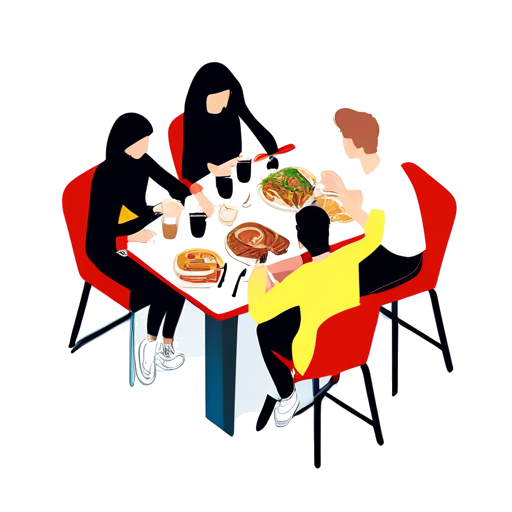
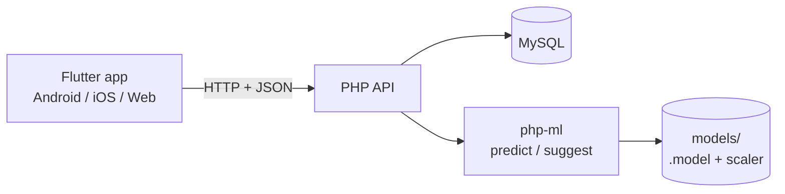

# سلف دانشگاه

سامانهٔ سلف دانشگاه؛ یک اپ Flutter برای دانشجو و یک API با PHP که پشتش می‌نشیند.

پروژهٔ درس پروژهٔ دانشگاه بود و بین تابستان ۱۴۰۳ تا شهریور ۱۴۰۴ روش کار کردم.
هدفش ساده بود: صف سلف را کوتاه کند. دانشجو از قبل غذا رزرو می‌کند، اعتبارش از
کیف پول کم می‌شود و مسئول سلف فقط غذا را تحویل می‌دهد.

<p align="center">
  
</p>

## چه کاری می‌کند

**اپ دانشجو**

- ورود با نام کاربری و رمز، نگه‌داشتن نشست با `shared_preferences`
- منوی روز به تفکیک صبحانه، ناهار و شام
- رزرو و لغو رزرو تا قبل از بسته‌شدن ظرفیت
- کیف پول: موجودی، شارژ و تاریخچهٔ تراکنش‌ها
- تیکت پشتیبانی
- صفحهٔ گزارش برای مسئول سلف (تعداد رزرو، درآمد، پرفروش‌ترین غذا)

**API**

- احراز هویت و مدیریت نشست
- رزرو، ظرفیت روزانه، کیف پول و تراکنش
- مدیریت غذاها و برنامهٔ هفتگی
- تیکت‌ها و تخصیص کارمند
- پیش‌بینی تقاضا با `php-ai/php-ml`

## بخش یادگیری ماشین

برای اینکه سلف بداند هر روز چقدر غذا بپزد، سه اسکریپت روی دادهٔ تاریخی رزروها کار می‌کنند:

| فایل | کار |
|---|---|
| `api/ai/train_ml.php` | آموزش مدل روی رزروهای گذشته |
| `api/ai/predict_ml.php` | پیش‌بینی تعداد پرس برای یک روز |
| `api/ai/suggest_week.php` | پیشنهاد برنامهٔ هفتهٔ بعد بر اساس پیش‌بینی |

مدل آموزش‌دیده و نرمال‌سازها در `api/models/` نگه‌داری می‌شوند
(`food_predictor.model`، `scaler.json`، `model_meta.json`).

## معماری



اپ هیچ منطق تجاری‌ای ندارد؛ هر صفحه فقط با API حرف می‌زند. API هم به همان
دیتابیس MySQL وصل است و لایهٔ MLش جدا از مسیرهای معمولی نگه داشته شده تا
اگر مدل جواب نداد، رزرو و کیف پول دست‌نخورده بمانند.

## ساختار

```
api/                 API با PHP
├─ ai/               آموزش و پیش‌بینی با php-ml
├─ auth/             ورود، نشست
├─ foods/            غذاها
├─ daily_food_plans/ برنامهٔ روز
├─ reservation/      رزرو
├─ wallet/           کیف پول و تراکنش
├─ tickets/          پشتیبانی
├─ dashboard/        گزارش‌ها: آمار رزرو، فروش، پرفروش‌ترین غذا
├─ selfs/            سلف‌ها
├─ assign_staff/     تخصیص کارمند
├─ models/           مدل آموزش‌دیده
└─ db.php            اتصال به دیتابیس

app/                 اپ Flutter
├─ lib/Core/         تم، مسیرها، ثابت‌ها
├─ lib/Features/     هر قابلیت: FirstPage، Breakfast، Lunch، Dinner، …
└─ assets/           تصاویر
```

## اجرا

**API**

```bash
cd api
composer install
DB_NAME=university_cafeteria DB_USER=root DB_PASS= php -S localhost:8000
```

**اپ**

```bash
cd app
flutter pub get
flutter run
```

آدرس API در کد اپ ثابت است؛ اگر جای دیگری اجرا می‌کنی، آدرس را در همان فایل
سرویس عوض کن.

## دیتابیس

ساختار جدول‌ها داخل مخزن نیست چون دامپ اصلی دادهٔ واقعی کاربران را داشت.
با اجرای اپ و ساختن چند غذا و کاربر می‌توانی ساختار را بازسازی کنی.

## وضعیت

کد همان چیزی است که آن زمان تحویل داده شد؛ بعد از آن دست نخورده.
چند چیز اگر امروز بنویسمش فرق می‌کند: نشست‌ها باید JWT باشند نه `$_SESSION`،
مسیرهای API نسخه‌بندی شوند (`/v1/...`)، و ورودی‌ها قبل از رسیدن به کوئری
اعتبارسنجی شوند. رمزها از همان اول با `password_hash` ذخیره می‌شدند.

## لایسنس

MIT — `LICENSE`
